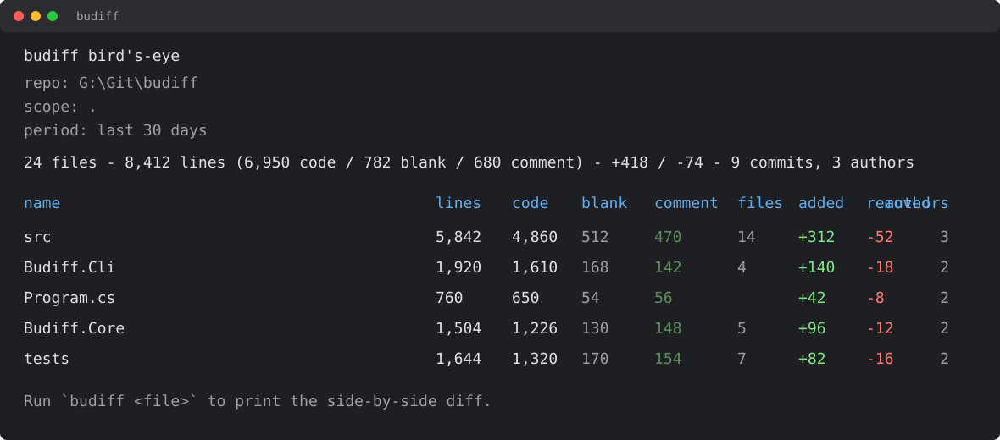
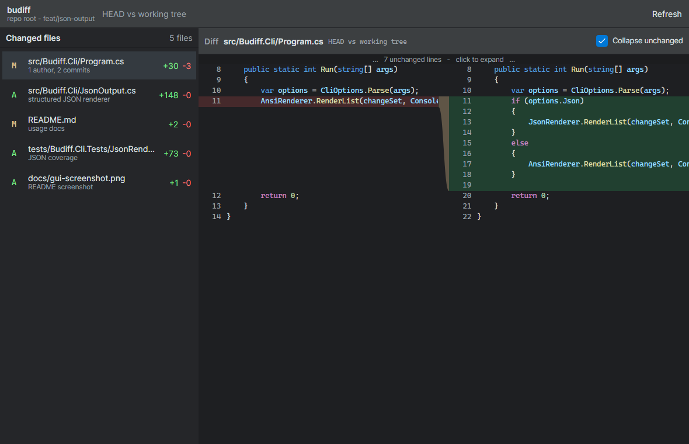
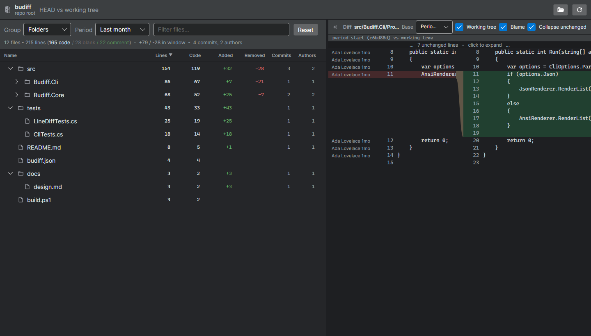

# budiff

**`ls`, but for your diffs.** Run it in a folder and instantly see what changed.



budiff is a folder-scoped, read-only diff viewer. The CLI opens with a Code Analysis bird's-eye: folders or projects, line/code/blank/comment counts, file counts, period churn, commits, and authors. Drill into a file to print a side-by-side diff. `--gitroot` widens scope to the whole repository. `-i` opens the desktop GUI on the same target:



Drilling into a file docks a syntax-highlighted side-by-side diff next to a compact bird's-eye - resizable, collapsible, and able to float into its own window:



## Install

Once published to NuGet:

```sh
dotnet tool install -g budiff
```

Release tags also attach self-contained, single-file CLI builds for users without the .NET SDK:

| Platform | Asset |
| --- | --- |
| Windows x64 | `budiff-win-x64.zip` |
| Linux x64 | `budiff-linux-x64.tar.gz` |
| macOS arm64 | `budiff-osx-arm64.tar.gz` |

One-line install scripts:

```powershell
irm https://raw.githubusercontent.com/VictorZakharov/budiff/main/scripts/install.ps1 | iex
```

```sh
curl -fsSL https://raw.githubusercontent.com/VictorZakharov/budiff/main/scripts/install.sh | sh
```

Set `BUDIFF_VERSION=v0.1.0` / `BUDIFF_INSTALL_DIR=...` for the shell script, or pass `-Version v0.1.0 -InstallDir ...` to the PowerShell script. Winget and Homebrew manifests are not published yet; the release assets and install scripts are the stable inputs for those manifests.

Native AOT is not enabled for the CLI yet. The CLI depends on LibGit2Sharp and native libgit2, which is not trim/AOT-friendly enough for a reliable first release. The release path is self-contained single-file publishing; AOT can be revisited if the git reader moves behind trim annotations or a git-CLI backend.

## Usage

```sh
budiff                 # show the bird's-eye for the current folder
budiff --gitroot       # show the bird's-eye for the whole repository
budiff --days 90       # widen the analysis window (default 30; 0 = all time)
budiff src/App.cs      # print a syntax-highlighted side-by-side diff for one file
budiff --base main --head feature/foo --gitroot
budiff --json          # emit the listing as structured JSON
budiff src/App.cs --json
git diff | budiff      # render a unified diff from stdin as side-by-side output
budiff --stdin         # explicit stdin pager mode
budiff mcp             # run the stdio MCP server for AI agents
budiff -i              # open the GUI
```

Outside a git repository, `budiff` still works: it falls back to a plain folder analysis (lines / code / blank / comment - no churn, commits, or authors). Terminal output is colored, and file diffs are syntax-highlighted with the same DarkPlus grammars the GUI uses; set `BUDIFF_FORCE_COLOR=1` to keep color when piping (e.g. `| less -R`).

The stdin mode is a pure unified-diff transform; it does not need repository access. `budiff mcp` exposes `list_changes`, `get_file_diff`, and `repo_overview` over stdio for MCP-capable AI coding agents. The GUI provides the same bird's-eye with filters, grouping, and period controls (including a custom window in days). The diff pane stays hidden until you drill into a file; it then docks on the right (the bird's-eye compacts to its core columns) with a base-branch picker and a working-tree toggle in its toolbar, the split is resizable, the tree can collapse away entirely, and the diff can pop out into its own window - handy on a second monitor.

Example MCP server config:

```json
{
  "mcpServers": {
    "budiff": {
      "command": "budiff",
      "args": ["mcp"]
    }
  }
}
```

## Performance

The bird's-eye scans files under the selected folder and uses git's path-scoped history for the selected period. The changed-file drill-in still bounds recent author/commit enrichment to 1,000 commits by default. Set `BUDIFF_HISTORY_MAX_COMMITS=0` to skip those drill-in counts, or set it to a larger number when you want a deeper window.

## Components

| Project | What it is |
| --- | --- |
| `Budiff.Core` | The diff engine - pure .NET, no UI, no git. |
| `Budiff.Avalonia` | The side-by-side diff control (Avalonia 12). |
| `Budiff.Avalonia.TextMate` | Optional TextMate syntax highlighting. |
| `Budiff.Cli` | The terminal tool (`budiff`). |
| `Budiff.App` | The standalone desktop GUI. |

## Build

```sh
dotnet build
dotnet test
```

Requires the .NET 10 SDK.

The UI snapshot test writes PNGs under the test output folder by default. Set `BUDIFF_UISNAPSHOT_DIR` to collect them elsewhere.

## License

[MIT](LICENSE).
