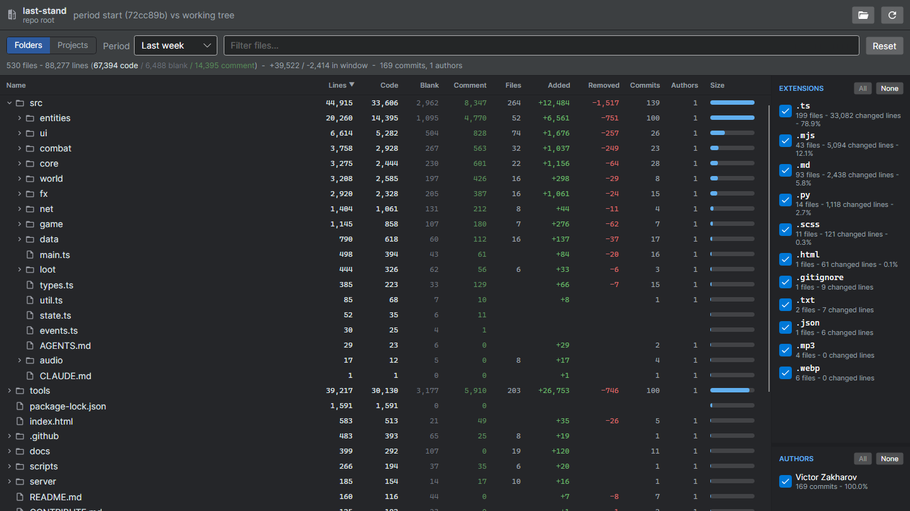
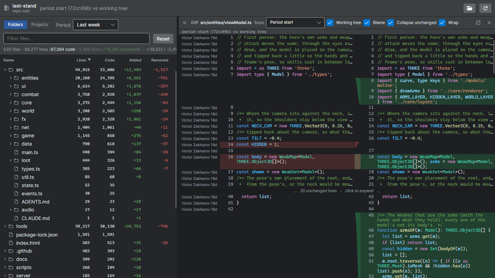
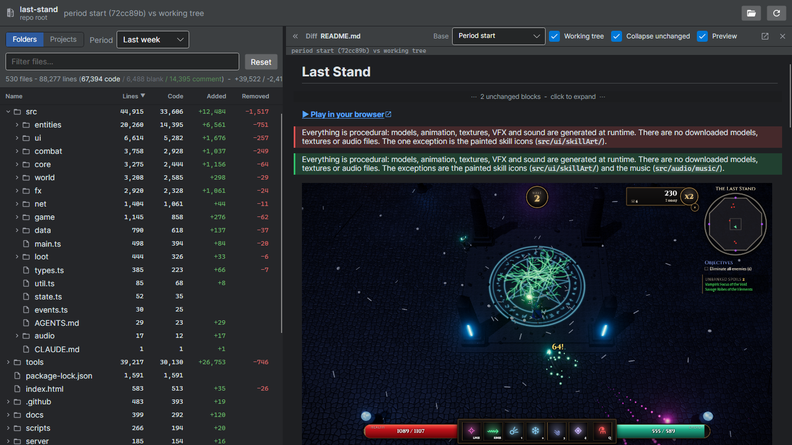
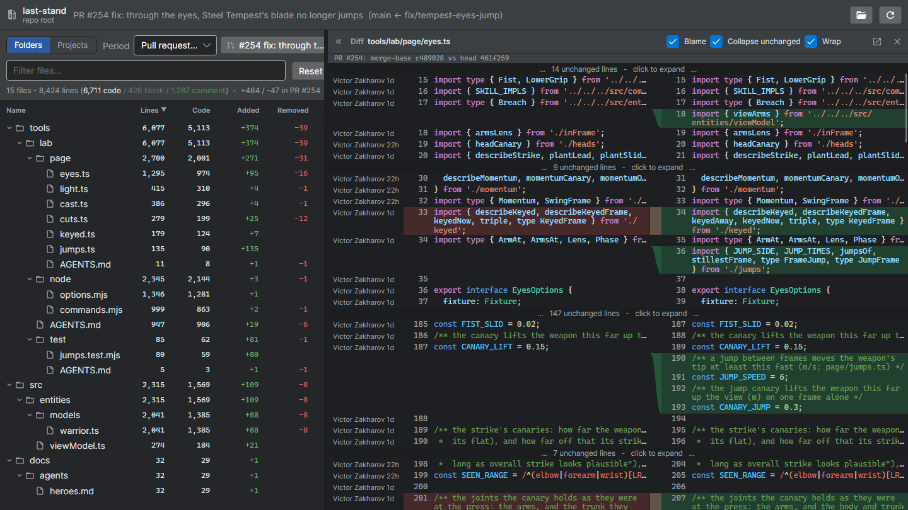

# budiff

[](https://www.nuget.org/packages/budiff/)
[](https://github.com/VictorZakharov/budiff/actions/workflows/ci.yml)
[](LICENSE)

**`ls`, but for your diffs.** Run it in a folder and see what changed there: lines added and removed per folder and file, commits and authors, then a side-by-side diff of any file. In the terminal, in a desktop app, or as JSON and an MCP server for AI agents. Read-only: it never changes your files or branches.

<table>
  <tr>
    <td width="50%"><a href="docs/screenshots/birdseye.png"></a><br><b>Bird's-eye</b> - what changed where, over a period</td>
    <td width="50%"><a href="docs/screenshots/diff.png"></a><br><b>Side-by-side diff</b> - syntax highlighting, blame, unchanged runs folded</td>
  </tr>
  <tr>
    <td width="50%"><a href="docs/screenshots/markdown.png"></a><br><b>Markdown preview</b> - rendered with its pictures, changed blocks marked</td>
    <td width="50%"><a href="docs/screenshots/pull-request.png"></a><br><b>Pull requests</b> - only what a PR changed, from its merge-base</td>
  </tr>
</table>

<sub>budiff on <a href="https://github.com/VictorZakharov/last-stand">last-stand</a>, a public game repository.</sub>

## Install

```sh
dotnet tool install -g budiff
```

Needs the [.NET 10 SDK](https://dotnet.microsoft.com/download) and git 2.11 or later on PATH. On Windows the tool includes the desktop app (`budiff -i`); on Linux and macOS it is the terminal tool for now ([#89](https://github.com/VictorZakharov/budiff/issues/89)).

Without .NET, use a self-contained build from the [releases](https://github.com/VictorZakharov/budiff/releases) (`budiff-win-x64.zip` with the desktop app, `budiff-linux-x64.tar.gz`, `budiff-osx-arm64.tar.gz`) or an install script:

```powershell
irm https://raw.githubusercontent.com/VictorZakharov/budiff/main/scripts/install.ps1 | iex
```

```sh
curl -fsSL https://raw.githubusercontent.com/VictorZakharov/budiff/main/scripts/install.sh | sh
```

## Use

```sh
budiff                 # the bird's-eye for the current folder (last 30 days)
budiff -r              # ... for the whole repository (--gitroot)
budiff --days 90       # another window (0 = all time)
budiff src/App.cs      # a syntax-highlighted side-by-side diff of one file
budiff --base main --head feature/foo
git diff | budiff      # any unified diff, side by side
budiff --json          # structured output for scripts and agents
budiff -i              # the desktop app on the same folder (Windows)
```


Outside a git repository it still works: a plain folder analysis (lines, code, blank, comment). `budiff --help` lists every option.

### Desktop app

- **Filter and group:** by extension and author, by folder or project, over a period: last week, month, 3 months, a custom window, or a pull request.
- **Pull requests:** pick one (yours by default; search by author, state, `#number` or text) and see only its changes, diffed from its merge-base. Uses the [GitHub CLI](https://cli.github.com) (`gh auth login`).
- **Diff:** docks next to the bird's-eye; blame, line wrap, unchanged runs folded, another base branch or the working tree, and it pops out into its own window for a second monitor.
- **Markdown preview:** Markdown and text documents render formatted, changed blocks marked (old in red, new in green), with the project's pictures (click one to zoom) and links that open the linked file.

## For AI agents

Agents work the way people do here: list what changed, then read only the files that matter - far cheaper than paging whole diffs into context.

- `budiff --json` (and `budiff <file> --json`) emit the change listing or one file's diff as JSON. `--context 3` folds long unchanged runs into `Gap` rows.
- `budiff mcp` runs a stdio MCP server with `list_changes`, `get_file_diff` (3 context lines by default; `contextLines` widens it, `null` for the whole file) and `repo_overview`.

```sh
claude mcp add budiff -- budiff mcp
```

Or in any MCP client's config:

```json
{
  "mcpServers": {
    "budiff": {
      "command": "budiff",
      "args": ["mcp"]
    }
  }
}
```

## Settings

| Environment variable | Effect |
| --- | --- |
| `BUDIFF_FORCE_COLOR=1` | Keep colors when piping, e.g. `budiff \| less -R`. |
| `BUDIFF_HISTORY_MAX_COMMITS` | How many recent commits the file drill-in reads for author and commit counts (default 1,000; `0` skips them). |
| `BUDIFF_APP_PATH` | Run a different build of the desktop app for `budiff -i`. |

## Libraries

The diff engine and the Avalonia side-by-side control are NuGet packages too:

| Package | What it is |
| --- | --- |
| `Budiff.Core` | The diff engine - pure .NET, no UI, no git. |
| `Budiff.Avalonia` | The side-by-side diff control (Avalonia 12). |
| `Budiff.Avalonia.TextMate` | Optional TextMate syntax highlighting. |
| `Budiff.Avalonia.Markdown` | Optional formatted Markdown preview (a block-level rich diff). |

## Build

```sh
dotnet build
dotnet test
```

Needs the .NET 10 SDK. UI snapshot tests write PNGs under the test output folder, or to `BUDIFF_UISNAPSHOT_DIR`. The screenshots above come from `ReadmeGridScreenshotTests` (set `BUDIFF_README_REPO` to a clone of last-stand).

## Contributing

Issues and pull requests are welcome - see [CONTRIBUTING.md](CONTRIBUTING.md). Report security problems privately as described in [SECURITY.md](SECURITY.md).

## License

[MIT](LICENSE). Third-party components and their licenses: [THIRD-PARTY-NOTICES.md](THIRD-PARTY-NOTICES.md).
